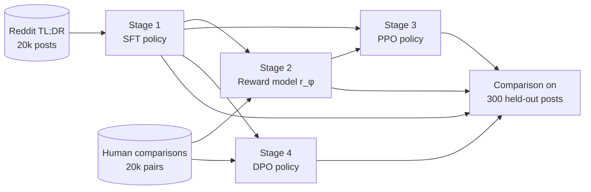

# TLDR-Align

**Aligning a 135M-parameter language model to human summary preferences — SFT, reward modelling, PPO and DPO, implemented from scratch in PyTorch.**

TLDR-Align reproduces the RLHF pipeline of [*Learning to Summarize from Human Feedback*](https://arxiv.org/abs/2009.01325) (Stiennon et al., 2020) end to end on [`HuggingFaceTB/SmolLM2-135M`](https://huggingface.co/HuggingFaceTB/SmolLM2-135M). Given a Reddit post, the model writes a one-sentence TL;DR. Four training stages gradually align it with human judgements of summary quality, and the final policies are compared side by side.

Every algorithm is written directly in PyTorch: the SFT loss, the Bradley–Terry reward model, PPO (rollouts, KL-shaped rewards, returns, clipped objective, value head) and DPO. There are no RLHF libraries (`trl`, `peft`, `trlx`, `OpenRLHF`), no `Trainer`, and no `AutoModelForSequenceClassification`. The full pipeline fits on a single free Colab or Kaggle T4.

<!-- Add: blog link · LinkedIn link  -->
**Links:** [Blog](#) · [LinkedIn](https://www.linkedin.com/in/qasimzubair/)(#)

---

## Pipeline



| Stage | Model | Learns | Data |
|---|---|---|---|
| 1. SFT | policy π_SFT | to write summaries by imitating human-written ones | 20,000 posts |
| 2. Reward model | r_φ(x, y) | to score a summary from human-ranked pairs (Bradley–Terry) | 20,000 pairs |
| 3. PPO | policy π_PPO + value head | to maximise r_φ while staying close to π_SFT (KL-penalised) | 3,200 prompts |
| 4. DPO | policy π_DPO | the same goal, directly from the ranked pairs, without a reward model | 20,000 pairs |

Stages 3 and 4 both start from the Stage 1 model. All methods are evaluated on 300 posts that none of them has seen.

## Quick start

```bash
git clone <this-repo> && cd tldr-align
pip install -r requirements.txt            # PyTorch, Transformers, Datasets, rouge-score, Gradio, ...
python starter/check_starter.py            # downloads data + model, prints subset sizes
./run_all.sh                               # SFT → reward → PPO → DPO → evaluation (logs in results/logs/)
```

Run stages individually:

```bash
python train_sft.py
python train_reward.py
python train_ppo.py
python train_dpo.py
python evaluate.py
```

Smoke test (a few minutes) before committing to a full run:

```bash
python train_sft.py --limit 64 && python train_reward.py --limit 64 \
  && python train_ppo.py --iterations 3 && python train_dpo.py --limit 64
```

### Using pretrained checkpoints

Training outputs go to `checkpoints/{sft,reward,ppo,dpo}/` (git-ignored). To skip training, run `python download_checkpoints.py` (pulls them from the Hugging Face Hub) or place the downloaded folders there; if they were trained in a notebook, run `python import_notebook_results.py` once so Table 2 can be rebuilt; `evaluate.py` and the demo only need these directories. To publish your own, run `HF_TOKEN=... python upload_checkpoints.py <user>/<repo>`.

### Demo

```bash
CHECKPOINTS=checkpoints python app/app.py
```

Paste a Reddit post and the app shows the SFT, PPO and DPO summaries side by side, each with its reward-model score.

<!-- Add screenshot:  -->

## Repository structure

```
starter/                 data loading, cleaning, tokenisation, batching, model loading
common.py                token_logprobs, summary_mask, pair batching, generation helper
train_sft.py             dataset statistics, mask check, Stage 1 (SFT)
train_reward.py          reward-model class, Stage 2 training, error analysis
train_ppo.py             value head, rollout, rewards, returns, PPO loss, Stage 3 training
train_dpo.py             Stage 4 (DPO)
evaluate.py              final comparison, tables, samples, human-evaluation sheet
app/app.py               Gradio demo
results/                 logs, tables, figures, generated summaries, analysis.md
run_all.sh               runs every stage and stores logs
upload_checkpoints.py    publishes checkpoints to the Hugging Face Hub
download_checkpoints.py  fetches checkpoints from the Hub into checkpoints/
import_notebook_results.py  rebuilds results/*_history.json from notebook-trained checkpoints
```

## Method details

**Data.** Cleaned Reddit TL;DR posts and human preference comparisons released with the original paper, in fixed random subsets (seed 42) so every run uses identical data. Prompts end with `\nTL;DR:`; summaries start with a space and end with EOS. Posts over 448 tokens and summaries over 48 tokens are dropped.

| Split | Size |
|---|---|
| SFT train / validation | 20,000 / 500 |
| Preference train / validation | 20,000 / 1,000 |
| Evaluation posts (held out) | 300 |

**Training configuration**

| Stage | Objective | Key settings |
|---|---|---|
| SFT | mean NLL over summary tokens | AdamW, lr 5e-5, batch 16, 1 epoch, grad-clip 1.0 |
| Reward model | Bradley–Terry: −log σ(r(x, y_w) − r(x, y_l)) | SmolLM2 body + linear head on the last real token; AdamW, lr 1e-5, 8 pairs/batch, 1 epoch |
| PPO | clipped surrogate + value loss − entropy bonus | ε 0.2, β_KL 0.05, c_V 0.1, c_H 0.01, γ 1.0, K = 4 epochs, 16 prompts × 200 iterations, AdamW lr 1e-5 |
| DPO | −log σ(β[Δ_w − Δ_l]) against a frozen reference | β 0.1, AdamW, lr 2e-6, 8 pairs/batch, 1 epoch |

**PPO.** Each generated token is an action. The per-token reward is the KL penalty against the frozen SFT reference plus the reward-model score at the final token. Returns are Monte-Carlo (γ = 1, no GAE) and advantages are normalised over all generated tokens. Each rollout is reused for four full-batch epochs; the 16 sequences are processed in two halves whose gradients are summed before a single optimizer step.

**Implementation notes**
- The reward model, DPO and evaluation operate on exactly the token ids produced by the data pipeline. Summaries are never re-tokenised from stripped text.
- The tokenizer's padding token is the EOS token, so masks are always derived from `attention_mask` or known lengths, never from `input_ids != pad_token_id`.
- Prompts are left-padded for generation; the reward model reads the hidden state of the last real token.
- Mixed precision (fp16 autocast) with gradient checkpointing; log-probabilities and the LM head in PPO are computed in fp32.

## Verification

Each stage asserts its own invariants at run time, and the output is stored in `results/logs/`.

| Check | Stage |
|---|---|
| Tokens selected by `summary_mask` decode to exactly the summary followed by EOS | SFT |
| Reference model and reward model have `requires_grad = False` | PPO, DPO |
| KL to the reference is 0 in the first PPO iteration (policy equals SFT) | PPO |
| In the first of K epochs of every iteration, r_t(θ) = 1 for every token and the clip fraction is 0 | PPO |
| Loss equals log 2 ≈ 0.6931 at the first step (π_θ = π_ref) | DPO |

## Evaluation

Computed on the 300 held-out posts with greedy decoding (≤ 48 new tokens):

- **Reward-model score:** mean r_φ(x, y) from the frozen reward model
- **Win rate vs. SFT:** share of posts where the method's summary scores higher than the SFT summary
- **KL to SFT:** summed log-ratio over the method's own greedy summary
- **Length:** mean generated tokens, EOS included
- **ROUGE-L:** F-measure against the human reference

A blind human evaluation on 30 fixed-seed posts complements the automatic metrics: two raters independently pick the best of three shuffled, unlabelled summaries (`python evaluate.py` creates the sheet; `python evaluate.py --tally` summarises it).

## Results

Full run on a single NVIDIA Tesla T4 (Kaggle), seed 42. Raw outputs are in `results/`.

**Data** (`results/table1_data.json`)

| | |
|---|---|
| SFT train / validation pairs | 20,000 / 500 |
| Preference train / validation pairs | 20,000 / 1,000 |
| Evaluation posts | 300 |
| Prompt length, SFT train (tokens), mean / max | 317.4 / 448 |
| Summary length, SFT train (tokens, incl. EOS), mean / max | 33.8 / 48 |

**Training** (`results/table2_training.csv`)

| Stage | Final train loss | Validation metric | Time (T4) |
|---|---|---|---|
| SFT | 2.339 | val. loss 2.351 | 40.3 min |
| Reward model | 0.608 | pairwise accuracy 0.638 | 82.8 min |
| PPO | −0.023 (policy loss, last 10 iterations) | mean r_φ 7.61 (last 10 iterations) | 24.8 min |
| DPO | 0.618 | implicit-reward accuracy 0.612 | 99.1 min |

**Final comparison on the 300 held-out posts** (`results/table3_final_comparison.csv`)

| Policy | Mean r_φ | Win rate vs. SFT | KL to SFT | Length (tokens) | ROUGE-L |
|---|---|---|---|---|---|
| SFT | 6.71 | – | 0 | 30.4 | 0.257 |
| PPO | 7.77 | 0.81 | 14.05 | 33.1 | 0.257 |
| DPO | 7.13 | 0.74 | 4.09 | 39.5 | 0.243 |

**Human evaluation, 30 posts** (`results/human_eval.csv`): _pending; will be added once both raters have completed the blind comparison._

Figures: `results/fig1_sft_loss.png`, `fig2_reward_model.png`, `fig3_ppo.png`, `fig4_dpo.png`. Qualitative examples are in `results/samples.md`; the discussion is in `results/analysis.md`.

### Key observations

- **SFT works as intended.** The base model tends to loop (repeating "I'm not sure if…" until the token limit), whereas the SFT model produces a single-sentence TL;DR (see `results/sft_before_after.json`).
- **The reward model is clearly better than chance but modest:** 63.8% pairwise accuracy on 1,000 validation pairs (362 errors). It is right 76% of the time when the human-preferred summary is the longer one, but only 47% when the preferred summary is the shorter one, so it has a clear bias towards longer, more detailed summaries.
- **PPO raises the reward-model score.** The mean sampled r_φ rose from about 5.9 in the first iteration to about 7.6 over the last ten, while the sampled KL to the reference grew to roughly 20 and the clip fraction stayed low (at most about 6%, typically 1–4%). On the held-out posts, PPO beats SFT on 81% of posts by r_φ, with a length close to SFT's (33.1 vs 30.4 tokens) and unchanged ROUGE-L.
- **DPO moves less but lengthens summaries.** DPO stays much closer to SFT in KL (4.1 vs 14.0 for PPO) and wins on 74% of posts, but its summaries are about 9 tokens longer than SFT's and its ROUGE-L is lower (0.243 vs 0.257).
- **DPO's implicit reward is almost as accurate as the explicit reward model** on the same 1,000 validation pairs (61.2% vs 63.8%), without ever training a reward model.
- **Cost:** PPO needs four models in memory (policy, value head, reference, reward model) but only 200 short iterations (25 min); DPO needs two (policy and reference) and a full pass over the 20,000 pairs (99 min in this implementation).
- **Caveat:** r_φ is the same reward model PPO optimises, so higher r_φ is not independent evidence of better summaries. The human evaluation is the check on that.

## Limitations

- A 135M-parameter model trained on 20k pairs is far smaller than the models in the original paper; the reward model reaches 63.8% accuracy and summary quality is correspondingly modest.
- PPO optimises the learned reward model, not human preference directly, so reward gains can come with length changes or lower ROUGE-L (reward over-optimisation).
- The human evaluation uses only 30 posts and two raters; treat it as indicative rather than statistically conclusive.
- Single seed per method; no variance estimates.

## References

- N. Stiennon et al., *Learning to Summarize from Human Feedback*, NeurIPS 2020. [arXiv:2009.01325](https://arxiv.org/abs/2009.01325)
- J. Schulman et al., *Proximal Policy Optimization Algorithms*, 2017. [arXiv:1707.06347](https://arxiv.org/abs/1707.06347)
- R. Rafailov et al., *Direct Preference Optimization*, NeurIPS 2023. [arXiv:2305.18290](https://arxiv.org/abs/2305.18290)
- Datasets: [`CarperAI/openai_summarize_tldr`](https://huggingface.co/datasets/CarperAI/openai_summarize_tldr), [`CarperAI/openai_summarize_comparisons`](https://huggingface.co/datasets/CarperAI/openai_summarize_comparisons)

The Reddit data contains real posts, some with mature language; treat it as research data.

## Authors

<!-- Qasim Zubair · https://github.com/qasimzubair -->